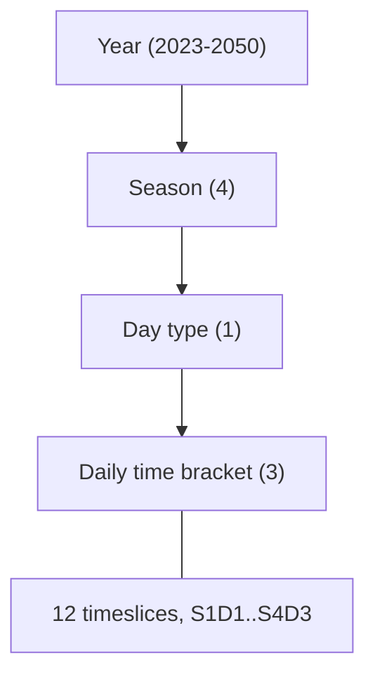

# Data Reference

This page documents the data file formats, naming conventions, and OSeMOSYS parameter structure used by OSTRAM LAC.

## Naming Conventions

### Technology Codes

Technology names in OSTRAM LAC follow a structured format that encodes the technology type, energy source, country, and region:

```
{PREFIX}{SOURCE}{COUNTRY}{REGION}
```

| Component | Length | Description | Examples |
|-----------|--------|-------------|----------|
| Prefix | 3 chars | Technology category | PWR, MIN, RNW, ELC, TRN |
| Source | 3 chars | Energy source | BIO, COA, SPV, WON, HYD |
| Country | 3 chars | ISO-3 country code | ARG, BRA, CHL |
| Region | 2 chars | Sub-region | XX (default); Brazil sub-regions e.g. CN, NE, SE |

**Examples:**

| Code | Meaning |
|------|---------|
| `PWRBIOARGXX` | Power + Biomass + Argentina + Default region |
| `MINCOAARG` | Mining + Coal + Argentina (MIN technologies carry no region suffix) |
| `RNWSPVCHLXX` | Renewable + Solar PV + Chile + Default region |
| `TRNARGXXBOLXX` | Interconnection between Argentina (XX) and Bolivia (XX) |

### Technology Prefixes

| Prefix | Description |
|--------|-------------|
| `PWR` | Power generation |
| `MIN` | Mining (commodity extraction) |
| `RNW` | Renewable resource supply (e.g. `RNWSPVCHLXX` makes the solar resource `SPVCHLXX` available to `PWRSPVCHLXX`); also the prefix of renewable transmission (`RNWTRN`, `RNWRPO`, `RNWNLI`) |
| `ELC` | Electricity distribution |
| `TRN` | Transmission (cross-border) |
| `DSPTRN` | Dispatch (interconnection routing) |

### Fuel Codes

Fuel names follow two patterns:

```
{SOURCE}{COUNTRY}{REGION}     # source fuels (renewables use region XX; mined/fossil fuels have no region)
ELC{COUNTRY}{REGION}{NN}      # electricity fuels (2-digit suffix NN encodes the electricity stage)
```

**Examples:**

| Code | Meaning |
|------|---------|
| `BIOARGXX` | Biomass fuel, Argentina |
| `COAARG` | Coal fuel, Argentina (mined fuels have no region suffix) |
| `ELCARGXX00` | Renewable electricity, Argentina |
| `ELCARGXX01` | Non-renewable electricity, Argentina |
| `ELCARGXX02` | Transmission output electricity, Argentina |
| `ELCARGXX03` | Demand node (final electricity demand) and export point to interconnections, Argentina |
| `ELCARGXX04` | Electricity imported through interconnections, Argentina |

### Emission Codes

```
CO2{COUNTRY}
```

Example: `CO2ARG` = CO2 emissions for Argentina.

### Storage Codes

Each storage type is modelled as a power technology with the `PWR` prefix (the charge/discharge side) linked to a storage facility of the same family (the energy side):

```
PWR{SDS|LDS|BDS}{COUNTRY}{REGION}     # technology
{SDS|LDS|BDS}{COUNTRY}{REGION}01      # storage facility
```

| Technology | Storage facility | Meaning |
|------|------|---------|
| `PWRSDSARGXX` | `SDSARGXX01` | Short Duration Storage (batteries), Argentina |
| `PWRLDSARGXX` | `LDSARGXX01` | Long Duration Storage (pumped hydro), Argentina |
| `PWRBDSCHLXX` | `BDSCHLXX01` | Backstop Duration Storage (BDS), Chile |

SDS and LDS exist for the 19 modelled countries and sit on the renewable electricity node `ELC*00`.

:::{important}
**BDS (Backstop Duration Storage) is the storage counterpart of the backstop.** It is a clone of SDS (same costs and technical parameters, no existing stock) connected to `ELC*02`, the post-transmission node that feeds demand, where the `PWRBCK` backstop also injects. Because it sits on the demand side of the transmission links, it can cover a shortfall that would otherwise be met with backstop generation (energy not served) without needing transmission capacity. It currently exists only for Chile and Peru, and is added after A3 with [`add_bds_storage.py`](../scripts/tools/data_patches/add_bds_storage.py) (see `scripts/tools/data_patches/README.md`).
:::

The Stage B2 storage-delay modifier (see {doc}`solver-patchers`) blocks their builds for the first N years using the prefixes in `storage_delay_storage_prefixes`.

---

## CSV File Structure

### SET Files

SET files define the elements of each OSeMOSYS set. They have a single column:

```text
VALUE
MINCOAARG
MINCOABOL
MINCOABRA
```

SET files in `OG_csvs_inputs/`:

| File | Content |
|------|---------|
| `TECHNOLOGY.csv` | All technology codes |
| `FUEL.csv` | All fuel codes |
| `EMISSION.csv` | All emission codes |
| `STORAGE.csv` | All storage codes |
| `REGION.csv` | Region codes (typically just `GLOBAL`) |
| `YEAR.csv` | Model years (2023--2050) |
| `TIMESLICE.csv` | Timeslice codes (S1D1, S1D2, ..., S4D3) |
| `SEASON.csv` | Season codes (1, 2, 3, 4) |
| `DAYTYPE.csv` | Day type codes (1) |
| `DAILYTIMEBRACKET.csv` | Daily time bracket codes (1, 2, 3) |
| `MODE_OF_OPERATION.csv` | Mode codes (1, 2) |

### Parameter Files

Parameter files contain data values indexed by OSeMOSYS dimensions. The column structure varies by parameter:

**4-column format** (Region, Technology, Year, Value):

```text
REGION,TECHNOLOGY,YEAR,VALUE
GLOBAL,PWRBCKARGXX,2023,999999.0
GLOBAL,PWRBIOARGXX,2023,1500.0
```

Used by: `CapitalCost`, `FixedCost`, `VariableCost`, `ResidualCapacity`, `TotalAnnualMaxCapacity`, `TotalAnnualMaxCapacityInvestment`, `AvailabilityFactor`, and others.

**6-column format** (Region, Technology, Fuel, Mode, Year, Value):

```text
REGION,TECHNOLOGY,FUEL,MODE_OF_OPERATION,YEAR,VALUE
GLOBAL,PWRBIOARGXX,BIOARGXX,1,2023,3.67
```

Used by: `InputActivityRatio`, `OutputActivityRatio`, `EmissionActivityRatio`.

**Other formats:**

- `CapacityFactor`: REGION, TECHNOLOGY, TIMESLICE, YEAR, VALUE
- `SpecifiedDemandProfile`: REGION, FUEL, TIMESLICE, YEAR, VALUE
- `TradeRoute`: REGION, FUEL, REGION, YEAR, VALUE

---

## Temporal Structure

OSTRAM LAC uses a hierarchical temporal structure:



This produces **12 timeslices** (4 seasons x 3 brackets):

| Timeslice | Season | Bracket | Description |
|-----------|--------|---------|-------------|
| S1D1 | 1 | 1 | Season 1, Bracket 1 |
| S1D2 | 1 | 2 | Season 1, Bracket 2 |
| S1D3 | 1 | 3 | Season 1, Bracket 3 |
| S2D1 | 2 | 1 | Season 2, Bracket 1 |
| ... | ... | ... | ... |
| S4D3 | 4 | 3 | Season 4, Bracket 3 |

### Conversion Matrices

Three matrices map timeslices to temporal dimensions:

- **Conversionls** (12x4): Maps timeslices to seasons (identity-like).
- **Conversionld** (12x1): Maps timeslices to day types (all 1).
- **Conversionlh** (12x3): Maps timeslices to daily time brackets.

---

## Excel Model Files

### A-O_Parametrization.xlsx

The main parameter file per scenario. Contains multiple sheets:

| Sheet | Content |
|-------|---------|
| Fixed Horizon Parameters | Non-yearly parameters: `CapacityToActivityUnit`, `OperationalLife`, … |
| Primary Techs | Yearly parameters of primary-supply technologies (`MIN*`, imports) |
| Secondary Techs | Yearly cost, capacity and activity-limit parameters of power technologies (`PWR*`), including `TotalAnnualMaxCapacityInvestment` and `TotalTechnologyAnnualActivityLowerLimit`; column G `Projection.Mode` decides which rows are used |
| Capacities | `ResidualCapacity`, `TotalAnnualMaxCapacity`, … |
| Yearsplit | `YearSplit` per timeslice |
| DaySplit | `DaySplit` per timeslice |
| VariableCost | `VariableCost` per technology and mode |
| Other_Techs | Auxiliary technologies outside the PWR/Demand families |
| Demand Techs | Parameters for demand and transmission technologies (`DSP*`, `TRN*`) |
| Vehicle Techs, Vehicle Groups, Transport Fuel Distribution | Transport-sector blocks kept from the OSeMOSYS-CLG template (not used by the electricity model) |
| Fuentes | Documentation sheet: data source, origin file/sheet and transformation per data block (added 2026-09-14 by `scripts/tools/data_patches/add_fuentes_sheet.py`). No year columns; `B1_Compiler.py` and `sync_historical_from_bau.py` skip it |

### A-O_Demand.xlsx

Demand data per scenario:

| Sheet | Content |
|-------|---------|
| Demand_Projection | `SpecifiedAnnualDemand` values |
| Profiles | `SpecifiedDemandProfile` timeslice distribution |
| Fuentes | Documentation sheet (data provenance), same convention as in `A-O_Parametrization.xlsx` |

See {doc}`sources` for a summary of the external datasets and national planning documents these `Fuentes` sheets cite.

### A-O_AR_Model_Base_Year.xlsx

Base year activity ratios:

| Sheet | Content |
|-------|---------|
| Primary | InputActivityRatio / OutputActivityRatio for primary supply |
| Secondary | Activity ratios for power generation |
| Demands | Activity ratios for demand technologies |

### A-O_AR_Projections.xlsx

Projection activity ratios (same structure as base year, with projection modes).

---

## OSeMOSYS Parameters Reference

### Cost Parameters

| Parameter | Unit | Description |
|-----------|------|-------------|
| `CapitalCost` | M$/GW | Overnight capital cost |
| `FixedCost` | M$/GW/yr | Annual fixed operation and maintenance cost |
| `VariableCost` | M$/PJ | Variable operation and maintenance cost |
| `CapitalCostStorage` | M$/GW | Storage capital cost |

### Capacity Parameters

| Parameter | Unit | Description |
|-----------|------|-------------|
| `ResidualCapacity` | GW | Existing installed capacity |
| `TotalAnnualMaxCapacity` | GW | Maximum total capacity allowed |
| `TotalAnnualMaxCapacityInvestment` | GW | Maximum new capacity per year |
| `TotalAnnualMinCapacity` | GW | Minimum required capacity |
| `TotalAnnualMinCapacityInvestment` | GW | Minimum new capacity per year |

### Performance Parameters

| Parameter | Unit | Description |
|-----------|------|-------------|
| `AvailabilityFactor` | fraction | Maximum available fraction of capacity |
| `CapacityFactor` | fraction | Capacity factor by timeslice |
| `CapacityToActivityUnit` | PJ/GW/yr | Conversion factor (typically 31.536) |
| `OperationalLife` | years | Technology lifetime |
| `InputActivityRatio` | - | Fuel input per unit activity |
| `OutputActivityRatio` | - | Fuel output per unit activity |

### Demand Parameters

| Parameter | Unit | Description |
|-----------|------|-------------|
| `SpecifiedAnnualDemand` | PJ | Annual energy demand |
| `SpecifiedDemandProfile` | fraction | Timeslice distribution (must sum to 1.0) |

### Emission Parameters

| Parameter | Unit | Description |
|-----------|------|-------------|
| `EmissionActivityRatio` | Mt/PJ | Emissions per unit activity |
| `AnnualEmissionLimit` | Mt | Maximum annual emissions |
| `ModelPeriodEmissionLimit` | Mt | Maximum total emissions |

### Activity Limits

| Parameter | Unit | Description |
|-----------|------|-------------|
| `TotalTechnologyAnnualActivityLowerLimit` | PJ | Minimum annual generation |
| `TotalTechnologyAnnualActivityUpperLimit` | PJ | Maximum annual generation |

### Storage Parameters

| Parameter | Unit | Description |
|-----------|------|-------------|
| `StorageLevelStart` | PJ | Initial storage level |
| `StorageMaxChargeRate` | GW | Maximum charging rate |
| `StorageMaxDischargeRate` | GW | Maximum discharging rate |
| `OperationalLifeStorage` | years | Storage technology lifetime |
| `ResidualStorageCapacity` | GW | Existing storage capacity |

---

## Model Architecture

OSTRAM LAC uses a single-region (`GLOBAL`) architecture where geographic granularity is embedded in the technology and fuel naming conventions. Each country's technologies operate independently, connected only through explicit transmission (TRN) technologies.

```{figure} /_static/reference/data_model_architecture.png
:name: fig-model-architecture
:width: 100%

Energy flow within one country, from supply to final demand and the interconnections with a neighbour: the code-level view of the structure in {ref}`Figure 1 <fig-ostram-structure>`.
```

`RNW` is **not** a separate node on the network: it plays, for renewables, the role that `MIN` plays for fossil fuels. Each `RNW{SOURCE}{COUNTRY}XX` technology (e.g. `RNWSPVCHLXX`) supplies the renewable resource (`SPVCHLXX`) that the matching renewable power plant (`PWRSPVCHLXX`) converts into electricity. Renewable resources are local: they cannot be traded between countries, unlike the commodities of `MIN`. The same prefix is reused by the renewable transmission technologies (`RNWTRN`, `RNWRPO`, `RNWNLI`), which carry renewable electricity from `ELC*00` to `ELC*02`.

### Energy Flow

1. **Supply technologies** provide primary energy: `MIN` for fossil commodities (coal, gas, oil, etc.) and `RNW` for local renewable resources (solar, wind, hydro, biomass, etc.).
2. **Power technologies** convert them into electricity: renewable plants deliver to `ELC*00`, non-renewable plants to `ELC*01`.
3. **Transmission technologies** carry electricity within the country to `ELC*02`: `RNWTRN`/`RNWRPO`/`RNWNLI` from `ELC*00`, `PWRTRN`/`TRNRPO`/`TRNNLI` from `ELC*01` (existing lines, repowering, new unplanned lines).
4. **Dispatch technologies** (DSPTRN) deliver to the demand node `ELC*03`: mode 1 from domestic transmission (`ELC*02`), mode 2 from imports (`ELC*04`).
5. **Interconnection technologies** (TRN) take electricity from a country's `ELC*03` and deliver it to the neighbour's `ELC*04` (export), or the other way round.
6. **Final demand** (`SpecifiedAnnualDemand`) is defined on `ELC*03`.
7. **Storage technologies** balance supply and demand across timeslices: SDS and LDS on `ELC*00`, BDS on `ELC*02`.
8. **Backstop** (`PWRBCK`) injects directly into `ELC*02` at a high cost; its output is reported as energy not served.
